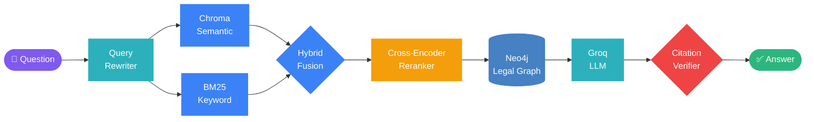
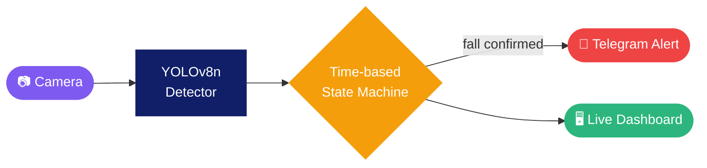

<!-- Header -->

  

  

  
  
  

## 🧠 About Me

- 🎓 Final-year **Data Science** student at **VNUHCM – University of Science**
- 🤖 Focus: **AI Engineering**, **Agent Systems** and **Computer Vision**
- 🌱 Currently learning: **production-grade agentic systems**

## 🛠️ Tech Stack

  

  
  
  
  
  
  

## 🚀 Featured Projects

### ⚖️ [Legal RAG Bot](https://github.com/qnghi13/legal-rag-bot): Vietnamese Labor Law Assistant

> Answers only from retrieved legal text, and every citation is verified before the answer is returned.

  

  
  
  
  
  
  

### 🧍 [Fall Detection System](https://github.com/qnghi13/Fall-Detection-System): Real-time Monitoring & Alerts

> Team of 3. **My role:** model selection & training, detector logic, deployment environment.

  
  
  

| Model | Params | Inference | mAP@50 | Fall Recall |
| :--- | ---: | ---: | ---: | ---: |
| 🏆 **YOLOv8n** | 3.0 M | 4.6 ms | **0.854** | **0.930** |
| YOLOv10n | 2.7 M | 3.4 ms | 0.803 | 0.803 |
| RT-DETR | 32.8 M | 17.9 ms | 0.805 | 0.915 |

  
  
  
  
  

## 📊 GitHub Stats

  

  
  

  

  <picture>
    <source media="(prefers-color-scheme: dark)" srcset="https://raw.githubusercontent.com/qnghi13/qnghi13/output/github-snake-dark.svg" />
    
  </picture>

<!-- Footer -->

  

